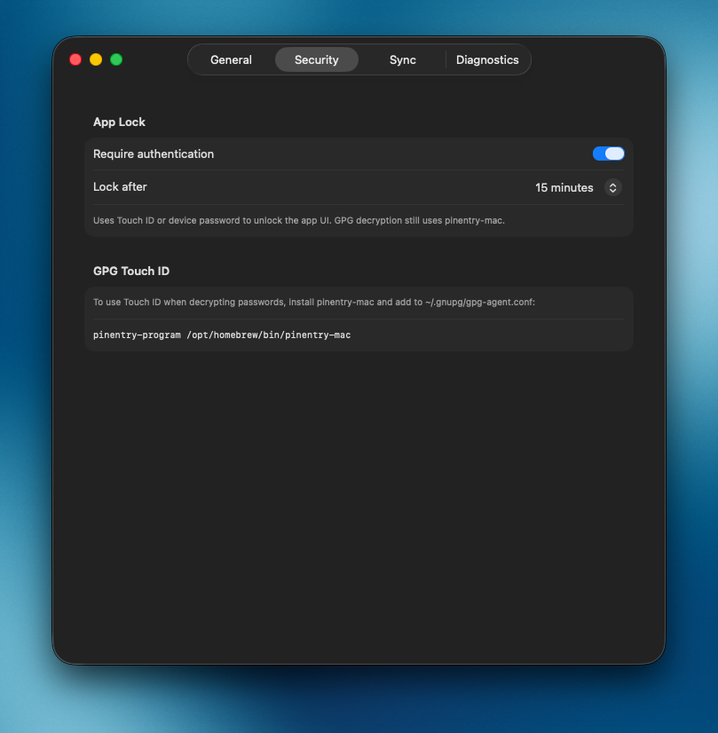

# Setup

Prefer the NativePass UI for store setup. Use Terminal for Homebrew packages, pinentry config, and optional CLI alternatives.

## 1. Install NativePass

```bash
brew tap li-nd/apps
brew trust li-nd/apps
brew install --cask nativepass
```

Or download from [GitHub Releases](https://github.com/li-nd/NativePass/releases).  
Shared tap: [li-nd/homebrew-apps](https://github.com/li-nd/homebrew-apps).

!!! warning "Gatekeeper"
    Current builds are ad-hoc signed and **not notarized**. On first launch macOS may block the app — use **System Settings → Privacy & Security → Open Anyway**, or right-click the app → **Open**.

## 2. Install core tools

```bash
brew install pass gnupg gnu-getopt pinentry-mac
```

Optional for TOTP CLI helpers: `brew install pass-otp` — see [Plugins](plugins.md). Package list: [Requirements](requirements.md).

## 3. Set up a password store

### In NativePass (recommended)

1. Launch NativePass from Applications (or build from Xcode).
2. On **Setup Required**:
   - **Create New Store…** — choose a path, select GPG keys, optionally **Initialize Git**, then **Create**.
   - Or **Choose Existing Folder…** if you already have a store on disk.
3. Open **Settings → Diagnostics** and confirm pass, GPG, and pinentry look healthy.
4. Manage more stores later under **Settings → Store** or the **Store** menu — see [Password stores](stores.md).


You need at least one GPG secret key on this Mac. NativePass lists keys in the create dialog.

### Optional: Terminal

If you prefer the CLI (or already use pass that way):

```bash
gpg --list-secret-keys --keyid-format LONG
pass init YOUR_GPG_KEY_ID
```

Optional Git backing:

```bash
pass git init
# then add a remote and push as usual
```

Default store path: `~/.password-store`. Then open NativePass and use **Choose Existing Folder…** (or it may pick up the default automatically).

## 4. Configure pinentry (passphrase popup)

Without `pinentry-mac`, GPG may fail to prompt cleanly from the app.

NativePass shows the recommended line under **Settings → Security**:



Add this to `~/.gnupg/gpg-agent.conf` (Apple Silicon Homebrew):

```text
pinentry-program /opt/homebrew/bin/pinentry-mac
```

On Intel Homebrew, use:

```text
pinentry-program /usr/local/bin/pinentry-mac
```

Reload the agent:

```bash
gpgconf --kill gpg-agent
```

Then open an entry in NativePass to confirm the passphrase dialog appears.

!!! note "App Lock vs GPG"
    **App Lock** (**Settings → Security**) protects the NativePass UI (Touch ID / device password).  
    **GPG decryption** still uses pinentry when your private key needs a passphrase.

## Next steps

- [Password stores](stores.md) — multiple stores, switch, encryption keys
- [Usage](usage.md) — browse, edit, sync
- [Quick Access](quick-access.md) — global hotkey
- [Troubleshooting](troubleshooting.md) — Diagnostics and common fixes
