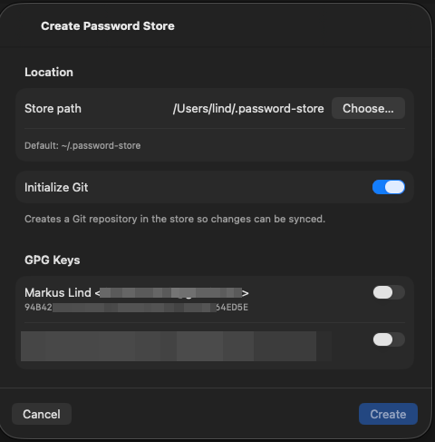
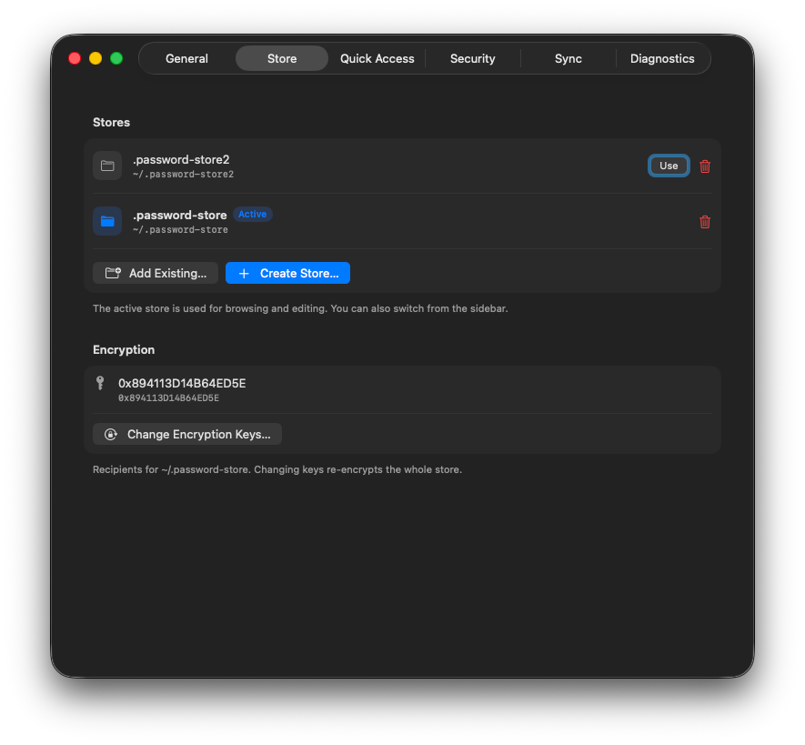
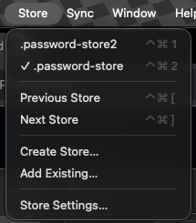
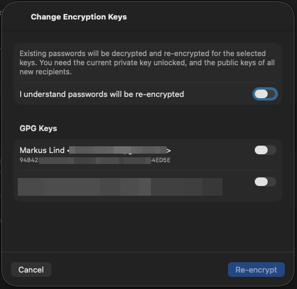

# Password stores

NativePass manages one or more [pass](https://www.passwordstore.org/) store folders. Only paths are saved in preferences; the **active** store sets `PASSWORD_STORE_DIR` for browsing, editing, sync, and [Quick Access](quick-access.md).

Related: [Setup](setup.md) (first launch + pinentry), [Usage](usage.md) (everyday browsing).

## Create a store

### In NativePass (recommended)

- First launch → **Create New Store…**
- Later → **Settings → Store → Create Store…**, or **Store → Create Store…**

Then:

1. Choose a **Store path** (default `~/.password-store`).
2. Optionally turn on **Initialize Git** so Pull / Push work later.
3. Select one or more **GPG keys** (recipients written to `.gpg-id`).
4. Press **Create**.



### Optional: Terminal

```bash
gpg --list-secret-keys --keyid-format LONG
pass init YOUR_GPG_KEY_ID
# optional:
pass git init
```

Then **Add Existing…** that folder in NativePass (or use the default `~/.password-store`).

## Add an existing store

**Settings → Store → Add Existing…** or **Store → Add Existing…** — pick a folder that already has a `.gpg-id` (a normal pass store). NativePass adds the path to the list and switches to it.

If the folder has no `.gpg-id`, use **Create Store…** instead so NativePass can run `pass init` for you.

## Switch stores

When more than one store is registered:

| How | Action |
|-----|--------|
| **Settings → Store** | Press **Use** on a store in the list |
| **Store** menu | Choose a store (checkmark = active) |
| **⌃⌘1** … **⌃⌘9** | Jump to store by list order |
| **⌃⌘[** / **⌃⌘]** | Previous / next store |





Switching reloads the sidebar, entry list, encryption map, and Git status for the new folder. Search, Quick Access, and sync always target the **active** store.

**Store → Store Settings…** opens **Settings → Store**.

## Remove a store from the list

In **Settings → Store**, use the trash control on a row. You can:

- Remove the path from NativePass only (files stay on disk), or
- Also delete the store folder from disk (confirmation required)

You cannot remove the last remaining store from the list.

## Encryption keys

pass encrypts each entry for the GPG recipients listed in the nearest `.gpg-id` (store root, or a folder with its own file). NativePass wraps `pass init` / `pass init -p` for:

| Action | Where | Effect |
|--------|--------|--------|
| Create store | **Create Store…** dialog | Writes root `.gpg-id` |
| **Change Encryption Keys…** | **Settings → Store** | Re-encrypts the **whole** active store |
| **Re-encrypt…** | Right-click a folder in the sidebar | Sets or updates that folder’s `.gpg-id` (`pass init -p`) |



When changing keys in the UI:

1. Read the warning — existing passwords are decrypted and re-encrypted.
2. Confirm **I understand passwords will be re-encrypted**.
3. Select the new recipient keys.
4. Press **Re-encrypt**. Your current private key must be unlockable (pinentry), and public keys for all new recipients must be available.

!!! note "Folder policies"
    Folders with their own `.gpg-id` show a people badge in the sidebar. Entry detail shows **Encrypted for:** based on the nearest `.gpg-id` above that entry.

### Optional: Terminal equivalents

```bash
# store root recipients
pass init KEY_ID [KEY_ID…]

# folder-level policy (relative path inside the store)
pass init -p folder/path KEY_ID [KEY_ID…]
```

## Get Info

- Right-click a **folder** → **Get Info…** — path, encryption policy, and related actions.
- Right-click an **entry** → **Get Info…** — file metadata for that password.

## Tips

- Paths only are stored in preferences — renaming a store folder on disk may require **Add Existing…** again and removing the old path.
- Each store can be its own Git repo; sync buttons apply to the active store only.
- App Lock protects the NativePass UI; GPG passphrase prompts are separate — see [App Lock](app-lock.md) and [Setup](setup.md).
